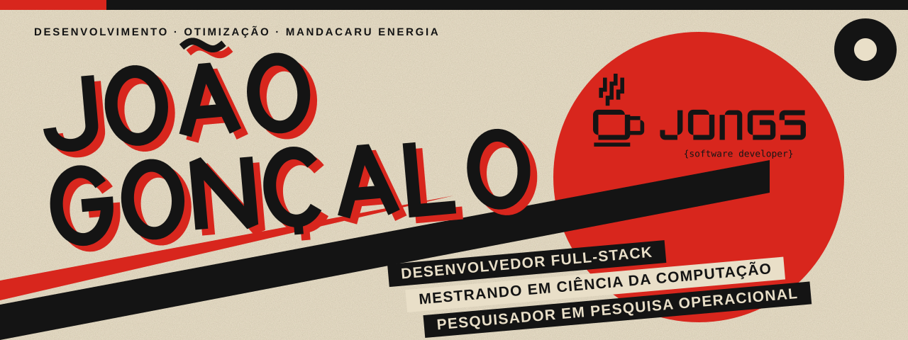
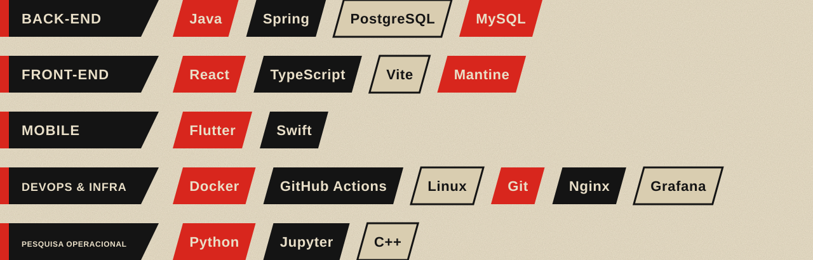

 

### Construo sistemas. Otimizo o que dá para otimizar.

Lidero o time de desenvolvimento na **Mandacaru Energia**, onde toco projetos como o **Mandacaru Hub** e passo por banco de dados, backend, frontend, infra e liderança de equipe. No mestrado, sigo com a pesquisa em **otimização de carteira de investimento** que comecei ainda na graduação.

- **No back-end:** Java e Spring, em camadas por feature e casos de uso, com JWT, RBAC hierárquico e, quando preciso, auditoria e observabilidade.
- **No front-end:** React em arquitetura hexagonal. Ultimamente testando Feature-Sliced Design, para organizar por fatia de funcionalidade e não por camada.
- **Na pesquisa:** implemento os algoritmos do zero em vez de só chamar biblioteca. Também contribuo com código aberto, como no [CUSTOMHyS](https://github.com/jcrvz/customhys).

 

 

| Projeto | Descrição |
|---|---|
| **Mandacaru Hub** *(privado)* | Sistema operacional central de uma empresa de petróleo, feito do zero: inventário, manutenção, treinamentos e e-learning próprio, em constante expansão. |
| **[DraeWiki](https://github.com/J0NGS/DraeWiki)** | API de Wiki/base de dados de um universo fictício de futebol. |
| **[MLO](https://github.com/J0NGS/MLO)** | Motor de Branch-and-Bound / Branch-and-Cut implementado do zero em Python, aplicado a 10 problemas clássicos de Pesquisa Operacional. |
| **[cplex_knapsack](https://github.com/J0NGS/cplex_knapsack)** | Resolução do Problema das Múltiplas Mochilas via IBM CPLEX, com benchmark e análise crítica dos resultados. |
| **[AnalisadorLEx](https://github.com/J0NGS/AnalisadorLEx)** | Analisador léxico e sintático (JFlex + JavaCup) para uma linguagem de ontologias no estilo Manchester OWL. |
| **[Cars-Store-ProgDistribuida-Ufersa](https://github.com/J0NGS/Cars-Store-ProgDistribuida-Ufersa)** | Loja de carros via CLI em microsserviços, em Java puro com RMI: gateway, servidores de descoberta e serviços separados de carros e usuários. |
| **[CUSTOMHyS](https://github.com/jcrvz/customhys)** *(contribuição)* | Framework de hyper-heurísticas para otimização contínua. [Contribuí](https://github.com/jcrvz/customhys/commit/98e24bf97951944f10129a714a9628d24aebcc5) com o suporte a operadores de inicialização identificados por prefixo, integrados ao loop principal da hyper-heurística. |

 

<picture>
  <source media="(prefers-color-scheme: dark)" srcset="../../dist/github-snake-dark.svg" />
  
</picture>

 

 

